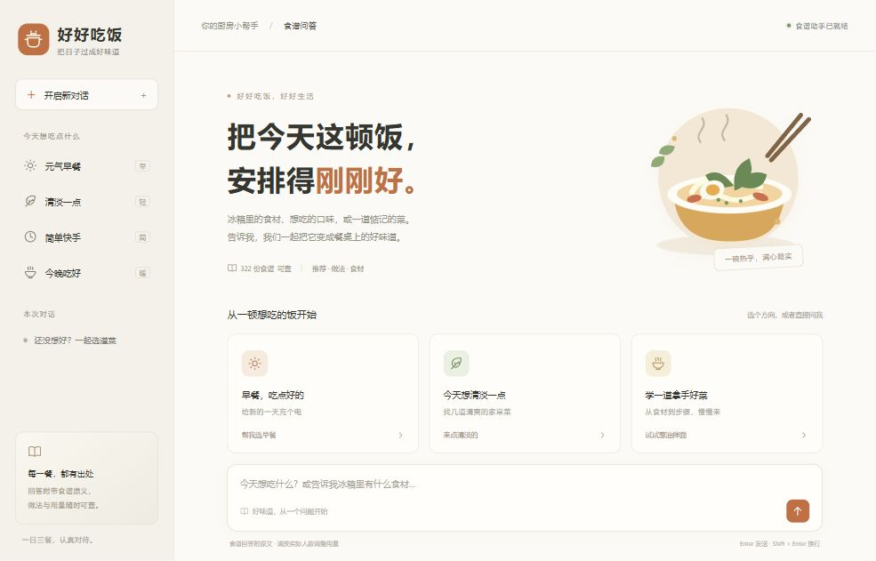
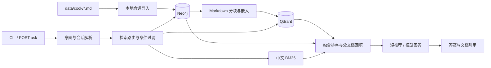

# Cook RAG

[](https://github.com/leonbuilds-ai/cook_rag/actions/workflows/ci.yml)


一个可以查食谱、选菜、继续追问的中文食谱助手。知识库包含 **322 份 Markdown 食谱、10 个分类**。Neo4j 保存菜品、食材和步骤之间的关系，Qdrant 负责语义检索，中文 BM25 补充关键词匹配。回答提供原文链接，可以直接检查用量和操作是否有依据。

现在自带「**好好吃饭**」中文问答网站。启动服务后访问 `http://127.0.0.1:8000/`，在聊天页面选菜、问做法、连续追问和查看食谱原文。无需另外安装前端环境。



项目从 Datawhale 的 C8/C9 示例演进而来，增加了 Qdrant 持久化、真实图关系查询、多轮对话和 FastAPI 服务。既可以在终端使用，也可以通过 HTTP 接入自己的界面。

```text
你：早餐吃什么
助手：1. 燕麦鸡蛋饼  2. 牛奶燕麦  3. 金枪鱼酱三明治
你：第一个怎么做
助手：解析为“燕麦鸡蛋饼：第一个怎么做”，查询原文并给出步骤和 [S1] 来源。
```

## 能做什么

| 功能 | 实现方式 |
| --- | --- |
| 中文问答网站 | 响应式聊天布局、真实流式回答、停止生成、复制回答、食谱原文弹窗 |
| 历史对话 | SQLite 保存多个对话，支持切换、搜索、重命名、删除和恢复；重启后可继续追问 |
| 快捷选菜 | 早餐、清淡、快手、晚餐分别检索；同一对话重复点击会换一批候选 |
| 原图展示 | 可用原图通过本地接口加载、统一卡片尺寸；空文件与 LFS 指针显示缺图占位 |
| 菜名、用量和做法查询 | 语义向量 + 中文 BM25 + RRF，补回完整食谱 |
| 食材筛选、排除条件 | 参数化 Cypher 查询实际 `REQUIRES` 关系 |
| 相似菜品、共享食材 | 有界的两跳图查询，与原文检索融合 |
| 推荐与偏好 | 推荐先展示简短名单；早餐按分类过滤，清淡条件依据完整原文保守筛选 |
| 连续追问 | 近期对话、独立推荐菜单、编号/标题解析；疑似菜名错误先确认 |
| 来源引用 | 答案中的 `[S1]` 标记、来源列表，以及 API 的结构化 `sources` |
| HTTP 接入 | `/ask`、`/ask/stream`、`/chats`、`/health`、OpenAPI 文档、可选 Bearer key |
| 运行维护 | TOML 配置、环境变量、轮转 JSON 日志、请求 ID、会话容量和 TTL |
| 检索评估 | 文档级 Recall@5、MRR@5，保留旧算法作对照，保存逐条排序结果 |

问候和感谢直接简短回复，不调用模型，也不会把检索出的几道菜说成整个知识库。新问题“早餐吃什么”会重新检索；“第二个怎么做”会根据当前会话的推荐名单补齐菜名。

## 技术栈与数据流

| 层 | 技术 |
| --- | --- |
| 服务 | Python 3.11+、FastAPI、Uvicorn、Pydantic |
| 编排与生成 | LangChain Core、Ollama / OpenAI 兼容接口 |
| 向量存储 | Qdrant 1.14 系列、余弦相似度、元数据前置过滤 |
| 图存储 | Neo4j 5、Recipe / Ingredient / CookingStep / Category |
| 文本检索 | jieba、rank-bm25、Reciprocal Rank Fusion |
| 网页与历史 | 原生 HTML / CSS / JavaScript、Fetch SSE、SQLite、浏览器归属 Cookie |
| 数据处理 | Markdown 标题分块、父文档回填、确定性文本块 ID |
| 质量检查 | unittest、内存 Qdrant、FastAPI TestClient、GitHub Actions |



图数据库保留完整原文，图关系只从原文提取，不让模型生成 Cypher。导入器仅更新本项目拥有的 `local-c9:` 节点与关系。Qdrant 集合按模型与数据指纹命名，构建结束后校验点数；数据或模型变更使用新集合，不自动删除其他集合。

## 快速开始

需要 Python 3.11+、运行中的 Neo4j 和 Qdrant，以及可用的模型服务。默认模型是 Ollama 的 `qwen3-embedding:8b` 和 `qwen3.5:9b`，可以通过 `.env` 换成自己的模型。本项目不自带模型权重。

```powershell
git clone https://github.com/leonbuilds-ai/cook_rag.git
cd cook_rag
py -3.11 -m venv .venv
.\.venv\Scripts\python.exe -m pip install -r requirements.txt
Copy-Item .env.example .env
# 编辑 .env，填写 Neo4j 密码以及数据库、模型的实际地址
ollama pull qwen3-embedding:8b
ollama pull qwen3.5:9b

# 先检查连接，再导入食谱和构建索引
.\.venv\Scripts\python.exe main.py --check
.\.venv\Scripts\python.exe main.py --import-local --build-only
.\.venv\Scripts\python.exe serve.py
```

已有 `.env` 时保留现有文件。已有索引的启动会直接复用；首次构建会显示向量化进度，需要等待模型完成。Linux/macOS 可使用 `python3 -m venv .venv`，后续将命令中的解释器替换为 `.venv/bin/python`。

服务默认监听 `127.0.0.1:8000`：

- [中文食谱助手网站](http://127.0.0.1:8000/)（日常使用入口）
- [健康检查](http://127.0.0.1:8000/health)
- [交互 API 文档](http://127.0.0.1:8000/docs)
- [OpenAPI JSON](http://127.0.0.1:8000/openapi.json)

PyCharm 中选择项目 `.venv` 解释器，右键运行 `serve.py`，看到服务启动成功后打开首页。停止时点击 Run 面板中的红色 Stop。若提示 8000 端口被占用，先确认是否已有后台实例；本项目脚本启动的实例可用 `scripts/stop-api.ps1` 停止。

网页输入框支持 Enter 发送、Shift+Enter 换行，并兼容中文输入法。模型生成的内容会边生成边显示，点击发送按钮所在位置的方块可停止。推荐下方可以点击菜名问做法，或点“换一批推荐”；`[S1]` 和来源卡片可查看完整原文。

左侧保存多段对话，可以搜索标题、切换、重命名或移到最近删除。刷新页面、重新打开浏览器或重启服务后，使用同一浏览器 Cookie 仍能访问历史并继续追问。聊天保存在 `runtime/history.sqlite3`，不会提交到 Git。网站使用本机接口；模型仍按 `.env` 配置调用。

## HTTP 调用

```powershell
$body = @{ question = "早餐吃什么" } | ConvertTo-Json
$reply = Invoke-RestMethod http://127.0.0.1:8000/ask -Method Post `
    -ContentType "application/json; charset=utf-8" -Body ([Text.Encoding]::UTF8.GetBytes($body))
$reply.answer

# 把 session_id 带到下一次请求，继续同一段对话
$followup = @{ question = "第一个怎么做"; session_id = $reply.session_id } | ConvertTo-Json
Invoke-RestMethod http://127.0.0.1:8000/ask -Method Post `
    -ContentType "application/json; charset=utf-8" -Body ([Text.Encoding]::UTF8.GetBytes($followup))
```

响应示意，菜品和排序以实际检索为准：

```json
{
  "answer": "…… [S1]\n\n文档来源：……",
  "sources": [
    {
      "id": "S1",
      "title": "燕麦鸡蛋饼",
      "document_id": "local-c9:…",
      "path": "data/cook/breakfast/燕麦鸡蛋饼.md",
      "url": "https://github.com/leonbuilds-ai/cook_rag/blob/main/data/cook/breakfast/%E7%87%95%E9%BA%A6%E9%B8%A1%E8%9B%8B%E9%A5%BC.md"
    }
  ],
  "session_id": "ec8ae3f3-9fad-4a07-97b8-0eb7ebc295e4",
  "resolved_query": "燕麦鸡蛋饼：第一个怎么做",
  "retrieval_strategy": "hybrid_traditional",
  "kind": "answer",
  "request_id": "ecf7204b-69e3-49ed-8509-6e37b7a46acf",
  "elapsed_ms": 9803.85
}
```

不传 `session_id` 就创建新会话；传回同一个 UUID 才能解析前文。`reset: true` 清空该会话。`strategy` 可选 `auto`、`hybrid_traditional`、`graph_rag`、`combined`。`/ask` 返回完整答案；网站通过 `/ask/stream` 接收 SSE，使用持久化的 `chat_id`。接口字段、错误码和两种会话规则见 [API 说明](docs/api.md)。

## 终端使用

```powershell
.\.venv\Scripts\python.exe main.py
.\.venv\Scripts\python.exe main.py --question "葱油拌面怎么做" --no-stream
.\.venv\Scripts\python.exe main.py --question "不要鸡蛋的素菜" --retrieve-only
.\.venv\Scripts\python.exe main.py --question "与西红柿炒鸡蛋相似的菜" --strategy combined
```

交互命令：`stats` 查看统计，`clear` 清空对话，`quit` 退出。修改食谱后执行 `--import-local --build-only` 同步图与索引；`--rebuild` 强制重建当前版本。所有命令都从项目根目录运行。

## 配置与部署

非敏感参数在 [settings.toml](settings.toml)，密码和 API key 在 `.env` 或进程环境变量。`RAG_CONFIG` 可指定其他配置文件；数据库和模型连接参数优先采用环境变量。完整参数、Docker 网络地址、启动与故障排查见 [运行与部署](docs/deployment.md)。

日志默认写入 `logs/cook_rag.jsonl`，单文件 10 MiB、保留 3 个备份。每个 HTTP 请求都有 `X-Request-ID`，错误响应也包含该 ID。服务日志不记录问题正文、回答正文或请求中的密钥。

当前服务使用一个 worker，模型请求串行执行。网页聊天与菜单持久化到 SQLite，每个浏览器通过随机 Cookie 访问自己的记录；这不是账号登录系统。旧 `/ask` 接口的会话仍保存在进程内，默认最多 200 个、空闲 1 小时过期。对外开放前设置 `APP_API_KEY`，通过 HTTPS 反向代理访问，并关闭 SSE 响应缓冲。多租户身份校验、分布式队列和多 worker 协同尚未实现。

仓库提供 API [Dockerfile](Dockerfile)，模型与数据库单独运行。Docker 构建和 Linux CI 配置已提供，本次本机验证使用 Windows 虚拟环境和现有 Docker 数据库。

本次接口、重启和检索的实际检查记录见 [验收报告](docs/validation-2026-10-12.md)。Windows 后台启动和停止可使用 `scripts/start-api.ps1`、`scripts/stop-api.ps1`。

## 检索评估

```powershell
.\.venv\Scripts\python.exe evaluate.py --output evaluation/results.json
.\.venv\Scripts\python.exe -m unittest discover -s tests -q
.\.venv\Scripts\python.exe -m pip check
```

本次在同一份 322 食谱、1761 文本块和 `qwen3-embedding:8b` 索引上对比：

| 数据范围 | 旧检索 Recall@5 | 新检索 Recall@5 | 旧检索 MRR@5 | 新检索 MRR@5 |
| --- | ---: | ---: | ---: | ---: |
| 全部 24 条 | 1.0000 | 1.0000 | 0.9042 | **0.9583** |
| 开发集 12 条 | 1.0000 | 1.0000 | 0.9167 | **1.0000** |
| 测试集 12 条 | 1.0000 | 1.0000 | 0.8917 | **0.9167** |

新检索先按食谱去重，再融合向量排名、完整食谱 BM25 和精确菜名匹配，并统一少量常见别名。旧检索保留为 `baseline`，可通过 `RETRIEVAL_MODE=baseline` 回退。

这是一个小规模人工标注集，Recall 已达到上限，提升主要体现在首个相关文档的排名。“吐司夹鸡蛋的早餐”从第 1 名退到第 2 名，逐条结果没有隐去退步。评估不包含回答质量和图路由，也不代表所有问题都能正确回答。标注、公式、实验边界和原始结果见 [评估说明](docs/evaluation.md) 与 [结果 JSON](evaluation/results.json)。

## 项目结构

```text
api.py / serve.py          HTTP 接口与启动入口
main.py                   RAG 编排与交互终端
config.py / settings.toml  检索、模型和数据配置
service_config.py         服务与日志配置
rag_modules/              图导入、Qdrant、检索、生成、会话、引用
web/                      中文聊天网站，HTML / CSS / JavaScript
web_routes.py             SSE、历史管理与本地图片接口
chat_store.py             SQLite 对话、菜单与推荐记录
recipe_media.py           安全的原图路径解析与校验
runtime/                  本地聊天数据库（不纳入 Git）
data/cook/                食谱原文与原有图片
evaluation/               标注问题和对比结果
evaluate.py               Recall@5、MRR@5 评估入口
tests/                    离线回归
docs/                     API、部署、评估文档
```

## 数据与参考

架构参考 [Datawhale all-in-rag C9](https://github.com/datawhalechina/all-in-rag/tree/main/code/C9)，参考版本 `cec956e80ae28d6c0ca84c9d39dddcf61ad633fd`。食谱沿用项目原有 C8 数据，本次只调整存放目录，没有重写食谱内容。转载食谱和图片时请核对原始数据的授权。

README 的组织参考了 [RAGFlow](https://github.com/infiniflow/ragflow) 和 [Haystack](https://github.com/deepset-ai/haystack) 对功能、运行环境和架构的介绍方式。项目的功能与验证结果以本仓库代码及报告为准。
