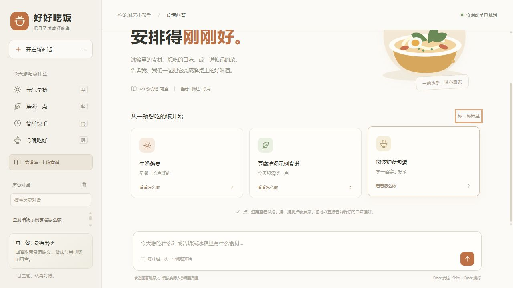
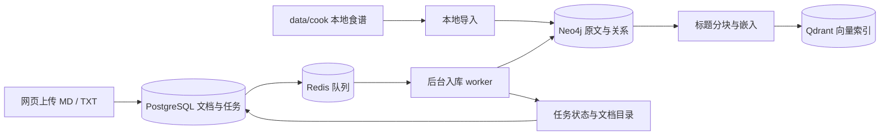
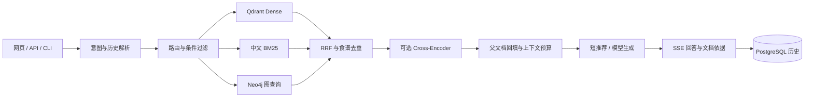

# Cook RAG

[](https://github.com/leonbuilds-ai/cook_rag/actions/workflows/ci.yml)


一个可以查食谱、选菜、继续追问的中文食谱助手。初始知识库包含 **322 份 Markdown 食谱、10 个分类**，也可以从网页上传自己的食谱。Qdrant 与中文 BM25 召回候选，使用 RRF 融合，支持可选的多语言 Cross-Encoder 重排；Neo4j 保留食材与步骤关系。回答附带原文，可以直接检查用量和操作是否有依据。

现在自带「**好好吃饭**」中文问答网站。启动服务后访问 `http://127.0.0.1:8000/`，在聊天页面选菜、问做法、连续追问和查看食谱原文。无需另外安装前端环境。



项目从 Datawhale 的 C8/C9 示例演进而来。目前包含网页问答、异步食谱入库、持久化历史、检索缓存和离线评估。业务记录放在 PostgreSQL，后台任务由 Redis 分发，Qdrant 保存向量，Neo4j 保存食材关系。既可以在终端使用，也可以通过 HTTP 接入自己的界面。

```text
你：早餐吃什么
助手：1. 燕麦鸡蛋饼  2. 牛奶燕麦  3. 金枪鱼酱三明治
你：第一个怎么做
助手：查询燕麦鸡蛋饼的原文，给出食材和步骤。展开“查看食谱依据”可以核对原文。
```

## 能做什么

| 功能 | 实现方式 |
| --- | --- |
| 中文问答网站 | 响应式聊天布局、真实流式回答、取消模型流、立即开启新对话、复制回答、可展开的食谱依据 |
| 历史对话 | PostgreSQL 保存多个对话，支持切换、搜索、重命名、删除和恢复；重启后可继续追问 |
| 文档入库 | 网页上传 Markdown / TXT，后台切块、嵌入与写入；阶段进度、失败重试和内容去重 |
| 数据持久化 | SQLAlchemy + PostgreSQL 保存浏览器用户、问答、菜单、文档、任务和评估；迁移原 SQLite 历史 |
| Redis | 后台任务分发、状态镜像、嵌入缓存和检索缓存；按模型与语料版本失效 |
| Cross-Encoder | 筛选与 RRF 后预测候选相关性，模型异常保留 RRF 并记录回退 |
| 回答评估 | Ragas 四项指标，保存实际上下文与答案，历史回放和分数缓存 |
| 快捷选菜 | 首页从真实食谱中换批；早餐、清淡、快手、晚餐分别检索，同一浏览器的新对话也能避开近期推荐 |
| 原图展示 | 可用原图通过本地接口加载、统一卡片尺寸；空文件与 LFS 指针显示缺图占位 |
| 菜名、用量和做法查询 | 语义向量 + 中文 BM25 + RRF，补回完整食谱 |
| 食材筛选、排除条件 | 参数化 Cypher 查询实际 `REQUIRES` 关系 |
| 相似菜品、共享食材 | 有界的两跳图查询，与原文检索融合 |
| 推荐与偏好 | 推荐先展示简短名单；早餐按分类过滤，清淡条件依据完整原文保守筛选 |
| 连续追问 | 近期对话、独立推荐菜单、编号/标题解析；疑似菜名错误先确认 |
| 来源引用 | 网页默认收起食谱依据，正文隐藏 `[Sx]`；API 保留来源标记和结构化 `sources` |
| HTTP 接入 | `/ask`、`/ask/stream`、`/chats`、`/health`、OpenAPI 文档、可选 Bearer key |
| 运行维护 | TOML 配置、环境变量、轮转 JSON 日志、请求 ID、会话容量和 TTL |
| 检索评估 | 文档级 Recall@5、MRR@5，保留旧算法作对照，保存逐条排序结果 |

问候和感谢直接简短回复，不调用模型，也不会把检索出的几道菜说成整个知识库。新问题“早餐吃什么”会重新检索；“第二个怎么做”会根据当前会话的推荐名单补齐菜名。

## 技术栈

| 组件 | 在项目中的职责 | 主要实现 |
| --- | --- | --- |
| Python 3.11+ | 后端、数据处理和评估脚本 | Python 模块、线程与 asyncio |
| FastAPI / Uvicorn / Pydantic | HTTP 服务、参数校验、错误响应、生命周期与 OpenAPI | `api.py`、`serve.py`、`web_routes.py` |
| LangChain Core | 组织提示词、历史消息、生成链和流式输出；统一接入不同模型 | `rag_modules/generation_integration.py`、`model_clients.py` |
| Ollama / OpenAI 兼容接口 | 生成回答和文本嵌入；模型地址与名称可配置 | 默认 `qwen3.5:9b` / `qwen3-embedding:8b` |
| Qdrant 1.14 | 保存文本块向量与元数据，执行 Dense 检索和条件过滤 | `rag_modules/index_construction.py` |
| jieba / rank-bm25 / RRF | 中文分词、关键词召回与排名融合，补充向量检索对菜名和用量的识别 | `rag_modules/retrieval_optimization.py` |
| Neo4j 5 | 保存食谱、食材、步骤和分类关系；查询共享食材及排除条件 | 参数化 Cypher、`GraphRAGRetrieval` |
| PostgreSQL 15 / SQLAlchemy 2 / psycopg 3 | 保存浏览器用户、聊天消息、菜单、文档、入库任务和评估结果 | `storage.py`；SQLite 用于离线测试和旧历史迁移 |
| Redis 7 | 分发入库任务，缓存嵌入与检索结果，保存任务状态镜像 | `redis_services.py`、`ingestion.py`；Redis List 队列 |
| Sentence Transformers / CrossEncoder | 对 query 与候选原文进行相关性打分，作为 RRF 后的可选重排 | `rag_modules/reranking.py`，默认关闭 |
| Ragas 0.3.9 | 离线评估答案忠实度、相关性、上下文精确率和召回率 | `evaluate_answers.py`，评估结果缓存到 PostgreSQL |
| HTML / CSS / JavaScript / Fetch SSE | 中文聊天页面、动态推荐、取消生成、历史与上传交互 | `web/`；无需前端编译 |
| Docker / Docker Compose | 运行数据库，持久化数据卷；提供可选 API 镜像 | 三份数据库 Compose 配置与 `Dockerfile` |
| unittest / GitHub Actions | 回归测试、依赖检查、Python 与 JavaScript 语法检查 | `tests/`、`.github/workflows/ci.yml` |

### 四种存储如何配合

**PostgreSQL 是业务记录的依据。** 文档全文、入库状态、聊天与评估都在这里，Redis 队列中的消息丢失后，可以按数据库中的未完成任务重新投递。浏览器用户是随机 Cookie 的归属记录，尚未实现账号登录。

**Redis 负责调度和减少重复计算。** 嵌入缓存包含模型与文本信息，检索缓存包含语料集合、问题、策略和筛选条件。换模型或换知识库不会拿到旧版本的结果。缓存不可用时走实际模型和检索，入库队列不可用时明确返回错误。

**Qdrant 与 Neo4j 分别支持语义检索和关系检索。** Qdrant 找与问题相近的原文，Neo4j 检查食材关系、分类和排除条件。向量集合按语料与模型指纹隔离，图导入只更新本项目拥有的数据，其他项目的数据不自动删除。

### 食谱如何入库

网页上传 UTF-8 Markdown / TXT 后，先校验格式并把文档、任务写入 PostgreSQL，再发送 Redis 队列消息。后台 worker 提取图关系、按 Markdown 标题切块、生成嵌入并构建 Qdrant 索引；完成检查后才切换活动集合。进度和失败原因可在网页查看，失败任务可重试，服务重启会恢复未完成任务。

文本块使用食谱内的稳定 ID。新建集合时复用父文档和正文一致的有效向量，只为缺少向量的块调用嵌入。一次上传失败会恢复原活动索引，并清理该次上传的图数据。当前采用一个 API 进程和一个后台 worker，问答与入库共享模型执行锁。



### 问答如何检索和生成

先判断问候、推荐或做法请求，再根据历史解析菜名、编号和来源编号。推荐使用检索命中的菜谱生成简短名单；问做法时，将完整父文档按预算补回上下文，交给模型生成。

常规检索由 Qdrant Dense 与完整食谱 BM25 分别召回，RRF 按食谱融合去重，并处理精确菜名和常见别名。食材关系问题可走图查询，也可以与原文检索组合。早餐分类、清淡规则和排除条件先约束候选，再执行可选重排。



Cross-Encoder 是实际模型推理，不是关键词排序的别名。当前使用多语言 `cross-encoder/mmarco-mMiniLMv2-L12-H384-v1`，本项目样本上的效果略低于 RRF，因此默认关闭；安装可选依赖并设置 `RERANK_ENABLED=true` 后可启用。下载或推理失败会保留 RRF 结果，并记录回退状态。

做法回答通过 Fetch 读取 SSE 的 status / start / metadata / delta / done / error 事件。停止时取消等待中的异步模型任务、关闭模型流和请求客户端，网页立刻允许新对话；同步图检索或嵌入仍需等待当前操作返回。来源保存在 API 与数据库中，网页将其收进“查看食谱依据”。

## 快速开始

实际检查见 [平台验收](docs/validation-platform-2026-10-13.md) 与 [交互验收](docs/validation-interactions-2026-10-13.md)，更详细的数据职责与恢复流程见 [架构说明](docs/upgrade-architecture.md)。

完整网站需要 Python 3.11+、Neo4j、Qdrant、PostgreSQL、Redis，以及可用的模型服务。默认模型是 Ollama 的 `qwen3-embedding:8b` 和 `qwen3.5:9b`，可以通过 `.env` 换成自己的模型。本项目不自带模型权重；下面的 Compose 启动 PostgreSQL、Redis 和 Qdrant，Neo4j 需提前启动并配置连接。

```powershell
git clone https://github.com/leonbuilds-ai/cook_rag.git
cd cook_rag
py -3.11 -m venv .venv
.\.venv\Scripts\python.exe -m pip install -r requirements.txt
Copy-Item .env.example .env
# 编辑 .env，填写 Neo4j 密码以及数据库、模型的实际地址
# DATABASE_URL 使用 POSTGRES_PASSWORD；REDIS_URL 使用 REDIS_PASSWORD
docker compose -p cook-rag-postgres -f compose.postgres.yaml up -d --wait
docker compose -p cook-rag-redis -f compose.redis.yaml up -d --wait
docker compose -p cook-rag-qdrant -f compose.qdrant.yaml up -d
ollama pull qwen3-embedding:8b
ollama pull qwen3.5:9b

# 先检查连接，再导入食谱和构建索引
.\.venv\Scripts\python.exe main.py --check
.\.venv\Scripts\python.exe main.py --import-local --build-only
.\.venv\Scripts\python.exe serve.py
```

已有 `.env` 时保留现有文件。已有索引的启动会直接复用；首次构建会显示向量化进度，需要等待模型完成。Linux/macOS 可使用 `python3 -m venv .venv`，后续将命令中的解释器替换为 `.venv/bin/python`。

依赖分成三组，日常问答只需第一组。后两组已经包含基础 requirements：

| 文件 | 用途 | 安装命令 |
| --- | --- | --- |
| `requirements.txt` | 网站、数据库、队列、混合检索与模型接入 | `python -m pip install -r requirements.txt` |
| `requirements-rerank.txt` | 可选 Cross-Encoder，包含 Sentence Transformers 与 Transformers | `python -m pip install -r requirements-rerank.txt` |
| `requirements-eval.txt` | 离线 Ragas 答案评估 | `python -m pip install -r requirements-eval.txt` |

安装命令中的 `python` 要使用运行项目的同一个虚拟环境解释器。

服务默认监听 `127.0.0.1:8000`：

- [中文食谱助手网站](http://127.0.0.1:8000/)（日常使用入口）
- [健康检查](http://127.0.0.1:8000/health)
- [交互 API 文档](http://127.0.0.1:8000/docs)
- [OpenAPI JSON](http://127.0.0.1:8000/openapi.json)

PyCharm 中选择项目 `.venv` 解释器，右键运行 `serve.py`，看到服务启动成功后打开首页。停止时点击 Run 面板中的红色 Stop。若提示 8000 端口被占用，先确认是否已有后台实例；本项目脚本启动的实例可用 `scripts/stop-api.ps1` 停止。

网页输入框支持 Enter 发送、Shift+Enter 换行，并兼容中文输入法。模型生成的内容会边生成边显示，点击方块可停止并马上开启新对话。首页“换一换推荐”和回答下方“换一批推荐”会避开本浏览器近期展示的菜。展开“查看食谱依据”可读原文，旧推荐中的 `S4` 等输入仍能定位对应菜名。

左侧保存多段对话，可以搜索标题、切换、重命名或移到最近删除。使用同一浏览器 Cookie 可以继续访问历史。设置 DATABASE_URL 后聊天保存在 PostgreSQL，启动时导入原 SQLite 文件并保留备份。侧栏“食谱库 · 上传食谱”支持上传 UTF-8 Markdown / TXT，后台完成入库后可以查询新菜并查看原文。

## HTTP 调用

| 接口 | 用途 |
| --- | --- |
| `POST /ask` | 返回完整答案，使用进程内的 session_id |
| `POST /ask/stream` | SSE 问答，使用持久化的 chat_id |
| `/chats` 与 `/chats/{id}` | 创建、列表、读取、重命名和软删除；恢复使用 restore 接口 |
| `POST /chats/{id}/stop` | 请求取消该对话正在执行的生成 |
| `POST /suggestions` | 按首页候选范围换批，支持排除近期展示的文档 |
| `POST /documents/upload` | 上传 MD / TXT 食谱并返回后台任务 |
| `GET /jobs`、`GET /jobs/{id}` | 查看任务阶段与进度，失败后可调用 retry 接口 |
| `GET /recipes/{document_id}` | 查看完整食谱原文 |
| `GET /health` | 检查服务和数据库、模型依赖状态 |

```powershell
$body = @{ question = "早餐吃什么" } | ConvertTo-Json
$reply = Invoke-RestMethod http://127.0.0.1:8000/ask -Method Post `
    -ContentType "application/json; charset=utf-8" -Body ([Text.Encoding]::UTF8.GetBytes($body))
$reply.answer

# 把 session_id 带到下一次请求，继续同一段对话
$followup = @{ question = "第一个怎么做"; session_id = $reply.session_id } | ConvertTo-Json
Invoke-RestMethod http://127.0.0.1:8000/ask -Method Post `
    -ContentType "application/json; charset=utf-8" -Body ([Text.Encoding]::UTF8.GetBytes($followup))
```

响应示意，菜品和排序以实际检索为准：

```json
{
  "answer": "…… [S1]\n\n文档来源：……",
  "sources": [
    {
      "id": "S1",
      "title": "燕麦鸡蛋饼",
      "document_id": "local-c9:…",
      "path": "data/cook/breakfast/燕麦鸡蛋饼.md",
      "url": "https://github.com/leonbuilds-ai/cook_rag/blob/main/data/cook/breakfast/%E7%87%95%E9%BA%A6%E9%B8%A1%E8%9B%8B%E9%A5%BC.md"
    }
  ],
  "session_id": "ec8ae3f3-9fad-4a07-97b8-0eb7ebc295e4",
  "resolved_query": "燕麦鸡蛋饼：第一个怎么做",
  "retrieval_strategy": "hybrid_traditional",
  "kind": "answer",
  "request_id": "ecf7204b-69e3-49ed-8509-6e37b7a46acf",
  "elapsed_ms": 9803.85
}
```

不传 `session_id` 就创建新会话；传回同一个 UUID 才能解析前文。`reset: true` 清空该会话。`strategy` 可选 `auto`、`hybrid_traditional`、`graph_rag`、`combined`。`/ask` 返回完整答案；网站通过 `/ask/stream` 接收 SSE，使用持久化的 `chat_id`。接口字段、错误码和两种会话规则见 [API 说明](docs/api.md)。

## 终端使用

```powershell
.\.venv\Scripts\python.exe main.py
.\.venv\Scripts\python.exe main.py --question "葱油拌面怎么做" --no-stream
.\.venv\Scripts\python.exe main.py --question "不要鸡蛋的素菜" --retrieve-only
.\.venv\Scripts\python.exe main.py --question "与西红柿炒鸡蛋相似的菜" --strategy combined
```

交互命令：`stats` 查看统计，`clear` 清空对话，`quit` 退出。修改食谱后执行 `--import-local --build-only` 同步图与索引；`--rebuild` 强制重建当前版本。所有命令都从项目根目录运行。

## 配置与部署

非敏感参数在 [settings.toml](settings.toml)，密码和 API key 在 `.env` 或进程环境变量。`RAG_CONFIG` 可指定其他配置文件；数据库和模型连接参数优先采用环境变量。完整参数、Docker 网络地址、启动与故障排查见 [运行与部署](docs/deployment.md)。

日志默认写入 `logs/cook_rag.jsonl`，单文件 10 MiB、保留 3 个备份。每个 HTTP 请求都有 `X-Request-ID`，错误响应也包含该 ID。服务日志不记录问题正文、回答正文或请求中的密钥。

当前服务使用一个 worker，问答与入库共用本机模型锁。网页聊天与菜单持久化到 PostgreSQL，每个浏览器通过随机 Cookie 访问自己的记录；这不是账号登录系统。旧 `/ask` 接口的会话仍保存在进程内，默认最多 200 个、空闲 1 小时过期。对外开放前设置 `APP_API_KEY`，通过 HTTPS 反向代理访问，并关闭 SSE 响应缓冲。多租户账号、多个 API 实例共享消费与分布式协同尚未实现。

原本的 Qdrant 位于 Windows 绑定目录，本机验证出现零向量与 `OutputTooSmall` 错误。项目现使用独立的 `cook-rag-qdrant-data` Docker 卷，地址为 `http://127.0.0.1:6335`；原 6333 实例及其他集合保留。不要把新实例的 storage 绑定到 Windows 目录。改造的数据职责、任务恢复和评估边界见 [架构说明](docs/upgrade-architecture.md)。

仓库提供 API [Dockerfile](Dockerfile)，模型与数据库单独运行。Docker 构建和 Linux CI 配置已提供，本次本机验证使用 Windows 虚拟环境和现有 Docker 数据库。

最新的停止生成、推荐换批与编号解析检查见 [交互验收](docs/validation-interactions-2026-10-13.md)，完整回归为 **86 项通过**。Windows 后台启动和停止可使用 `scripts/start-api.ps1`、`scripts/stop-api.ps1`。

## 检索与回答质量评估

```powershell
# 对比 baseline、recipe RRF 和真实 Cross-Encoder
.\.venv\Scripts\python.exe -m pip install -r requirements-rerank.txt
.\.venv\Scripts\python.exe evaluate.py --output evaluation/results-reranked.json

# 评估已经保存的答案；capture 只补充缺少答案或上下文的样本
.\.venv\Scripts\python.exe -m pip install -r requirements-eval.txt
.\.venv\Scripts\python.exe evaluate_answers.py --capture --limit 3
# 回放同一份答案，不再生成，并复用已保存的评估分数
.\.venv\Scripts\python.exe evaluate_answers.py --limit 3 --output evaluation/answer-replay-results.json

# 工程回归，不依赖运行中的数据库或本机模型
.\.venv\Scripts\python.exe -m unittest discover -s tests -q
.\.venv\Scripts\python.exe -m pip check
```

### 检索排序

按食谱文档去重后计算 Recall@5 与 MRR@5。2026-10-13 在同一份 322 食谱、1761 文本块和 `qwen3-embedding:8b` 索引上完成三组对照，使用 24 条人工标注问题：

| 算法 | Recall@5 | MRR@5 |
| --- | ---: | ---: |
| baseline：文本块融合后取食谱 | 1.0000 | 0.9250 |
| recipe：食谱级 RRF、菜名与别名处理 | **1.0000** | **0.9583** |
| reranked：RRF 后加入 Cross-Encoder | 0.9792 | 0.9514 |

新检索先按食谱去重，再融合向量排名、完整食谱 BM25 和精确菜名匹配，并统一少量常见别名。旧检索保留为 `baseline`，可通过 `RETRIEVAL_MODE=baseline` 回退。

当前重排模型没有整体提升，因此 `.env.example` 默认关闭重排。模型功能与评估入口保留，可通过 `RERANK_ENABLED=true` 验证其他模型后再启用。逐条结果、模型、语料指纹与集合名保存在 [三组对照报告](evaluation/results-reranked.json)，此前的两组实验仍保存在 [历史报告](evaluation/results.json)。

这是一个小规模人工标注集，Recall 已达到上限，改进主要体现在首个相关文档的排名。报告保留提升与退步的全部案例，实验不包含图路由、历史解析或答案生成，不能据此推断所有问题的回答准确率。标注、公式与实验边界见 [评估说明](docs/evaluation.md)。

### Ragas 答案评估

样本保存实际问题、答案、生成时的上下文和人工参考答案。可以回放 JSON 样本，也可以用 `--chat-id` 加 `--reference` 评估 PostgreSQL 中某段对话的最后一条完整回答。评估模型使用配置中的 LLM 与 Embedding，不要求额外的在线评估服务。

| 指标 | 关注的问题 | 三条样本平均分 |
| --- | --- | ---: |
| faithfulness | 回答中的事实是否由检索上下文支持 | 1.0000 |
| answer_relevancy | 回答是否对应用户问题 | 0.8633 |
| context_precision | 排在前面的上下文是否有用 | 约 1.0000 |
| context_recall | 上下文是否覆盖参考答案需要的信息 | 1.0000 |

分数来自三条明确的食材、用量与步骤问题，不能代表全站准确率。相同样本和评估配置的分数直接从 PostgreSQL 读取；底层评估模型调用还有磁盘缓存。更换答案、上下文、人工参考或模型配置会产生新的缓存键。再次回放实测 3/3 命中分数缓存，没有重复调用评估模型。样本与结果见 [答案样本](evaluation/answer_samples.json)、[答案评估](evaluation/answer-results.json) 和 [缓存回放](evaluation/answer-replay-results.json)。

## 项目结构

```text
api.py / serve.py          HTTP 接口与启动入口
main.py                   RAG 编排与交互终端
config.py / settings.toml  检索、模型和数据配置
service_config.py         服务与日志配置
rag_modules/              图导入、Qdrant、检索、生成、会话、引用
web/                      中文聊天网站，HTML / CSS / JavaScript
web_routes.py             SSE、历史管理与本地图片接口
document_routes.py        上传、任务查询与失败重试
chat_store.py / storage.py SQLAlchemy 对话、文档、任务和评估存储
ingestion.py               Redis 后台入库与失败恢复
redis_services.py          队列、嵌入与检索缓存
evaluate_answers.py        Ragas 捕获、历史回放与分数缓存
rag_modules/reranking.py   可选 Cross-Encoder
rag_modules/cancellation.py 异步模型调用与流式取消
requirements*.txt          基础、重排与评估依赖
compose.*.yaml             PostgreSQL、Redis、Qdrant 本机容器
recipe_media.py           安全的原图路径解析与校验
runtime/                  SQLite 备份、模型与评估缓存（不纳入 Git）
data/cook/                食谱原文与原有图片
evaluation/               标注问题和对比结果
evaluate.py               Recall@5、MRR@5 评估入口
tests/                    离线回归
docs/                     API、部署、评估文档
```

## 数据与参考

架构参考 [Datawhale all-in-rag C9](https://github.com/datawhalechina/all-in-rag/tree/main/code/C9)，参考版本 `cec956e80ae28d6c0ca84c9d39dddcf61ad633fd`。食谱沿用项目原有 C8 数据，本次只调整存放目录，没有重写食谱内容。转载食谱和图片时请核对原始数据的授权。

实现细节和复现步骤分别见 [架构说明](docs/upgrade-architecture.md)、[API 说明](docs/api.md)、[部署说明](docs/deployment.md) 和 [评估说明](docs/evaluation.md)。
