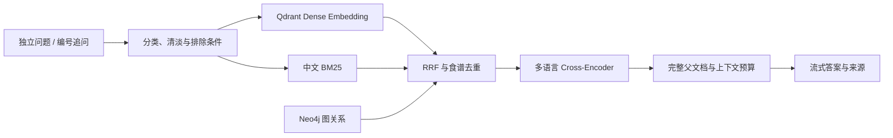

# 存储、异步入库与检索升级

这次改造沿用现有中文网站和食谱数据，补齐 PostgreSQL、Redis、Cross-Encoder 与 Ragas。没有改为 Vue，也没有加入 PDF、OCR、Word 或图片理解。上传范围为带食材和步骤章节的 UTF-8 Markdown / TXT 食谱。

## 数据职责

| 组件 | 保存内容 | 故障边界 |
| --- | --- | --- |
| PostgreSQL / SQLAlchemy | 匿名浏览器用户、聊天、消息、菜单、文档全文与元数据、入库任务、评估样本与分数 | 数据库不可用时不创建假成功记录 |
| Redis | 入库队列、任务状态镜像、嵌入与检索结果缓存 | 缓存不可用时回到真实模型 / 检索；上传队列不可用时明确提示 |
| Qdrant | 文本块的向量与检索 payload | 按语料指纹创建新集合，旧集合保留 |
| Neo4j | 食谱、食材、步骤和分类关系 | Cypher 参数化；上传关系采用独立标签与 owner |

用户表记录随机浏览器 Cookie 的 SHA256 归属标识，支持原有历史隔离，不是账号登录。共享本机食谱库对当前服务的使用者可见，任务与聊天按浏览器归属检查。开启 APP_API_KEY 后上传、历史和查询使用相同服务访问验证。

旧 SQLite 历史在启动时幂等导入 PostgreSQL，保留对话 ID、菜单和浏览器归属，原文件不删除。SQLite 后端继续用于不依赖 Docker 的单元测试。表结构由 SQLAlchemy 创建；当前是初始 schema，未来改变既有字段需单独设计迁移，不会自动删除或重建生产表。

## 后台入库

上传最多 50 MiB，校验扩展名、UTF-8、非空文本、标题、食材与步骤，以及分类。上传提交文档和 queued 任务到 PostgreSQL，再投递 Redis。网页马上返回任务 ID，在食谱库中显示阶段与进度。

单个后台 worker 依次执行校验、提取图关系、Markdown 切块、嵌入、Qdrant 写入与目录更新。它与问答共用模型执行锁，避免同时争抢本机模型。任务执行期间其他问题可能收到繁忙提示；任务查询和页面操作仍可用。

新增食谱时按父文档与块正文复用旧向量，写入当前块 ID 和元数据，只为缺少向量的块调用嵌入；所有点数验证通过后才启用新索引。块 ID 使用食谱内部偏移，新增其他食谱不会改变已有 ID。缓存按模型、provider、地址、上下文参数和文本分隔；检索缓存另包含集合指纹、问题、策略、筛选条件和重排模型，换库后不会复用旧候选。

任务账本以 PostgreSQL 为准。服务启动时重新投递 queued / running 任务，修复提交后未投递以及进程中断的窗口；重复投递的已完成任务会跳过，单浏览器相同内容不重复入库。失败恢复上一个活动索引与检索器，仅回滚这次上传的图数据；失败任务可从网页重试。仍采用单进程、单 worker，不支持多个 API 实例同时消费或跨进程热更新。

## 检索链路

Cross-Encoder 在筛选后的候选中预测真实的 query / passage 相关性分数，不替换为关键词打分。CPU 模型缓存于 runtime/models；下载或推理异常会明确记录 fallback_rrf，保留原候选。来源消息包含 retrieval_trace，可区分是否使用重排、缓存及对应集合。重排不是营养规则，不能越过早餐或清淡筛选。

## 两类评估

当前默认 `RERANK_ENABLED=false`。24 条真实检索样本中，RRF 的 Recall@5 / MRR@5 为 1.000000 / 0.958333，加入所选重排模型后为 0.979167 / 0.951389。保留模型和开关供继续实验，详细逐条结果见 [检索评估](evaluation.md)。

`evaluate.py` 在同一份语料、同一向量库上对照旧 baseline、recipe RRF 与 reranked，报告 Recall@5、MRR@5 和延迟。重排模型未真正生效时评估会失败，不把回退结果标为重排提升。

`evaluate_answers.py` 使用 Ragas 0.3.9，评估 faithfulness、answer_relevancy、context_precision、context_recall。样本包含实际答案、生成时的检索上下文和人工参考答案。先 capture 一次，再离线 replay；回放不重新生成答案。生成后的网页回答也可以从 PostgreSQL 按 chat-id 选取最近一条完整回答，提供人工 reference 后评估。

分数缓存的键包含样本内容、参考答案、评估框架版本、指标、judge / embedding 模型与配置。相同样本回放可以直接读 PostgreSQL 分数，不再调用大模型；底层 Ragas 的模型调用也使用磁盘缓存。输出保留 cache_hit 与运行时间，不照搬简历中的 20% 或 30% 指标。人工样本很少，不能代表所有真实问题。

实现参考：[SQLAlchemy PostgreSQL](https://docs.sqlalchemy.org/en/20/dialects/postgresql.html)、[Cross-Encoder 使用](https://sbert.net/docs/package_reference/cross_encoder/model.html)、[所用模型](https://huggingface.co/cross-encoder/mmarco-mMiniLMv2-L12-H384-v1)、[Ragas 指标与模型配置](https://docs.ragas.io/en/v0.3.9/howtos/customizations/customize_models/)。
