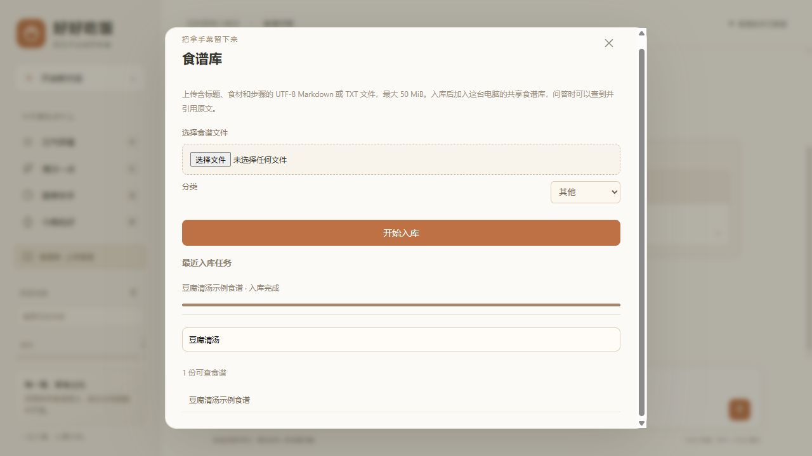

# 平台升级验收 · 2026-10-13

在本机 Windows、Python 3.12.14 环境完成验证，保留原生网页。PostgreSQL 15、Redis 7、Neo4j 5、Qdrant 1.14.1 均在 Docker 运行；生成和嵌入使用本机 Ollama。未加入 Vue、PDF、OCR 或多模态解析。

## 实际数据与服务

- PostgreSQL 已接通。原 SQLite 的 9 段对话、68 条消息迁入，保留 ID 和浏览器归属；原文件保留。
- 网页上传 `docs/examples/豆腐清汤示例食谱.md`，后台任务从排队到完成。服务重启后仍可查到任务、文档与原文。
- 当前知识库为 323 份食谱、1764 个文本块，包含这一份明确标注为示例的食谱。活动集合为 `recipe_c9_a416c5fa7fceb2c12833`。
- `/health` 返回 ready，Neo4j、Qdrant、embedding、llm、PostgreSQL、Redis 六项均为 ok。
- 实际流式提问“豆腐清汤示例食谱怎么做”，回答包含豆腐 150 克、清水 300 毫升、小火煮 5 分钟；点击 `[S1]` 显示上传原文。上传文档不会生成虚假的 GitHub 链接。
- 最终重启后，两次独立会话查询同一菜谱，首次 trace 为 cache_hit=false，第二次为 true，标明当前集合与 disabled 重排状态。模型回答仍真实生成。

## Qdrant 持久化修复

原 6333 容器在 Windows 路径 `D:\qdrant_storage` 上挂载存储，本次检测遇到 payload 读取异常，旧集合采样向量为全零。没有删除该容器和其他项目的集合。

新增 `cook-rag-qdrant`，使用 Docker named volume，在本机 `127.0.0.1:6335` 提供接口，并从食谱重建真实向量。容器重启后 payload 仍可读取，抽样向量范数为 1.0。本地 `.env` 已切换至该地址。使用 IPv4 明确地址也避免了 localhost 的连接回退等待。

块 ID 改为食谱内偏移，新增其他食谱不再改变已有块的 ID。升级时按父文档和正文复用有效旧向量，重新写入当前元数据；全零向量不复用。构建未完成时不会切换活动索引。

## 问答交互

真实服务 `scripts/check-stream.py --url http://127.0.0.1:8090` 验证：

- 早餐快捷入口连续两次返回不同的三道菜。
- “第一个怎么做”定位到第二批中的蒸花卷。
- 首个 delta 约 2.396 秒，346 个 delta，约 5.497 秒完成。这是一次本机烟雾测试，不能作为并发性能基准。
- 停止生成后消息状态为 stopped，删除、恢复对话正常。
- 浏览器上传、阶段进度、目录搜索、原文弹窗和新食谱问答均实测通过；最后检查没有浏览器 error / warn 日志。

## 检索与答案质量

24 条检索问题、原始 322 份食谱上，recipe RRF 的 Recall@5 / MRR@5 为 1.000000 / 0.958333；真实 Cross-Encoder 为 0.979167 / 0.951389。默认关闭重排，保留实验开关；没有宣称命中率提高 20%。报告保留全部问题与回退案例，见 [评估说明](evaluation.md)。

三条真实生成答案经 Ragas 0.3.9 和本机 qwen3.5:9b 评估，平均 faithfulness 为 1.000000、answer_relevancy 为 0.863335、context_precision 约 1.000000、context_recall 为 1.000000。重复回放 3/3 命中 PostgreSQL 分数缓存，计分阶段约 0.012 秒，没有再次调用评估模型。样本仅覆盖三道菜的明确用量与步骤问题，不能推断全站回答准确率，也不是人工审核替代品。

修复了连续评估复用已关闭 asyncio loop 的问题：每份未缓存样本创建独立模型客户端，已经缓存的样本直接读分数。

## 工程检查

`python -m unittest discover -s tests -q`：79 项通过。新增覆盖 SQL 文档和任务隔离、重复入库、分数缓存、真实 pairwise 重排调用与异常回退、嵌入版本隔离、上传校验、失败索引回滚、稳定块 ID 和旧向量复用。

`pip check`、Python compileall、`node --check web/app.js`、`git diff --check` 均通过。失败注入测试中的 backend / ingestion / fallback 日志属于预期输出。数据库容器和真实 API 已运行验证；应用 Docker 镜像没有在本次构建，不将 Dockerfile 静态检查称为部署成功。

仍采用单 API 进程、单后台 worker；入库时模型锁可能导致问答返回繁忙。用户记录为匿名浏览器归属，没有账号登录。接口与历史保留本机使用方式，上传食谱在当前服务内共享。
